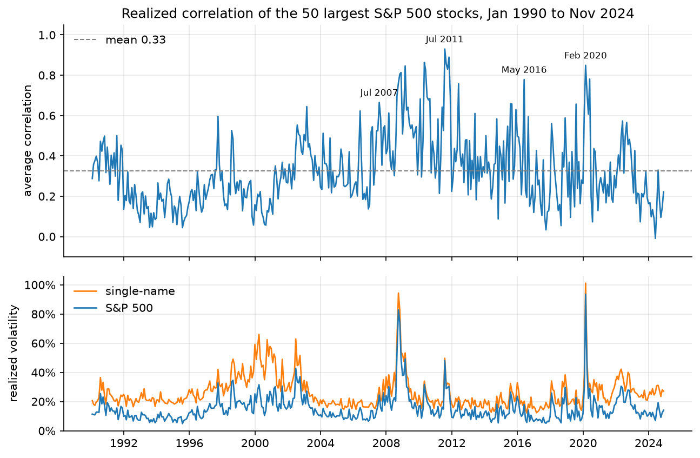
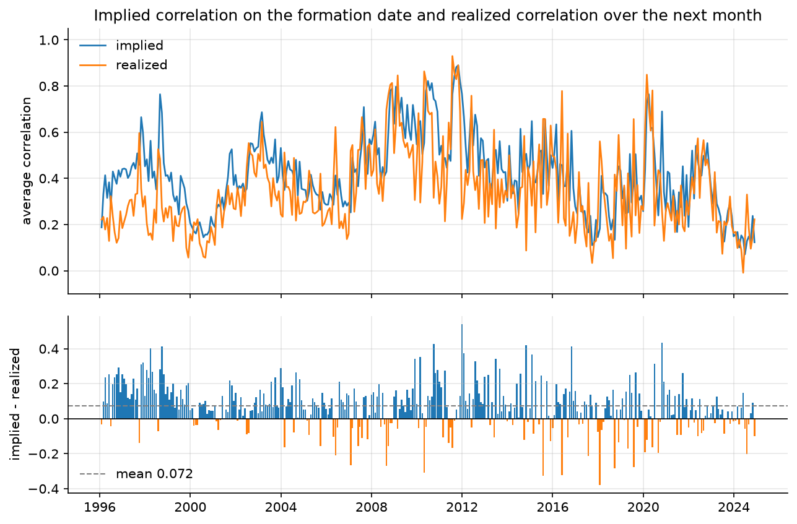
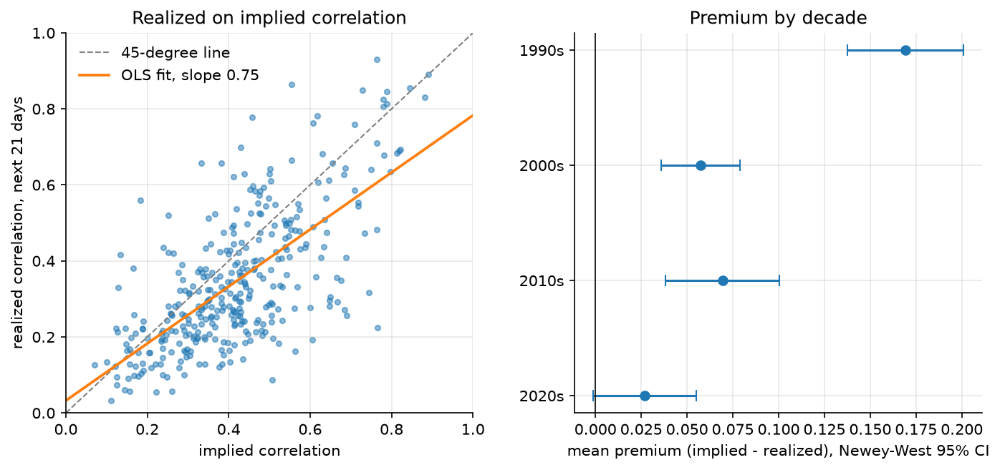
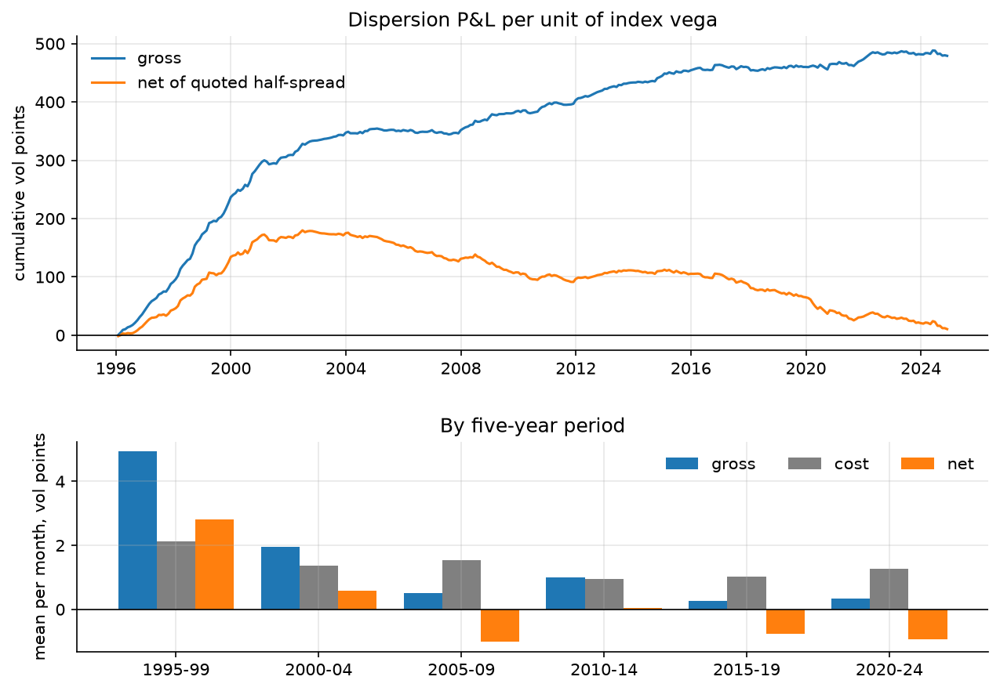
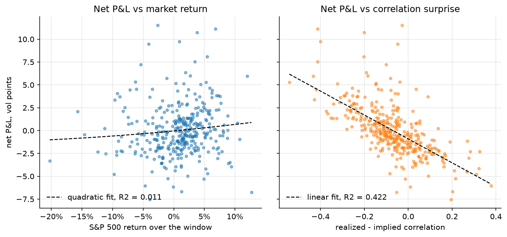

# Correlation risk premium

[](https://github.com/petersifter/correlation-risk-premium/actions/workflows/ci.yml)

S&P 500 index options are expensive relative to options on the stocks in the index. The gap is
the price of correlation, and the trade that sells it is dispersion: short an index straddle, long
straddles on the constituents, sized so the book has no net vega.

This repo measures implied and realized correlation monthly from 1990 to 2024 on the 50 largest
S&P 500 stocks, tests whether implied correlation has been too high, and prices the dispersion
trade using the bid-ask spreads that were actually quoted on the options it would have traded.

Summary:

- Implied correlation averaged 0.418 and subsequently realized correlation 0.346 over 346 monthly
  windows (1996-2024). The gap of 0.072 has a Newey-West t-statistic of 7.74 and was positive in
  72% of months.
- The gap has shrunk from 0.169 in the 1990s to 0.027 since 2020, and the 2020s confidence
  interval (-0.001 to 0.055) includes zero.
- The trade doesn't cover its costs. Gross P&L averages 1.385 vol points per unit of index vega
  and the quoted half-spread costs 1.354, leaving 0.030 (t = 0.14, Sharpe 0.04 +/- 0.19). Net of
  costs it was clearly profitable only before 2005.

Driessen, Maenhout and Vilkov (2009) showed that correlation risk is priced in index options using
S&P 100 data for 1996-2003. This project extends the measurement to 2024 and asks whether the
premium survives the cost of the 51-leg position needed to collect it.

## Average correlation

Let $w_i$ be basket weights summing to 1, $\sigma_i$ constituent volatilities, $\rho_{ij}$
pairwise correlations and $\sigma_I$ the index volatility. Since $R_I = \sum_i w_i R_i$,

```math
\sigma_I^2 = \sum_i \sum_j w_i w_j \rho_{ij} \sigma_i \sigma_j
           = \sum_i w_i^2 \sigma_i^2 + \sum_{i \ne j} w_i w_j \rho_{ij} \sigma_i \sigma_j
\qquad (1)
```

A 50-name basket has 1,225 pairwise correlations and none of them is quoted. Replacing every
$\rho_{ij}$ with one number $\bar\rho$ and solving gives

```math
\bar\rho = \frac{\sigma_I^2 - B}{A^2 - B},
\qquad A = \sum_i w_i \sigma_i,
\qquad B = \sum_i w_i^2 \sigma_i^2
\qquad (2)
```

using $\sum_{i \ne j} w_i w_j \sigma_i \sigma_j = A^2 - B$. With implied volatilities this is
implied correlation; with realized volatilities it is realized correlation.

Substituting (1) into (2) shows $\bar\rho$ is a weighted mean of the $\rho_{ij}$ with positive
weights $w_i w_j \sigma_i \sigma_j$, so it stays inside their range, and it is exact when all the
pairwise correlations are equal. Both are tested in `tests/test_correlation.py`.

This is the construction behind Cboe's implied correlation indices. The COR3M white paper defines
the index as SPX implied variance minus the implied variance of an uncorrelated portfolio of the
top 50 names, divided by the sum of pairwise weighted volatility products. That is (2) with the
diagonal term $B$ included. A common shortcut, $\sigma_I^2 / A^2$, drops it.

## Data

All from WRDS:

| source | table | fields |
| --- | --- | --- |
| CRSP daily stock file | `crsp.dsf` | `date`, `permno`, `ret`, `retx`, `prc`, `shrout` |
| CRSP daily index file | `crsp.dsi` | `date`, `sprtrn`, `vwretd` |
| S&P 500 membership | `crsp.dsp500list` | `permno`, `start`, `ending` |
| OptionMetrics surface | `optionm.vsurfd{year}` | `secid`, `date`, `days`, `delta`, `cp_flag`, `impl_volatility` |
| OptionMetrics quotes | `optionm.opprcd{year}` | `secid`, `date`, `exdate`, `delta`, `vega`, `best_bid`, `best_offer` |
| CRSP-OptionMetrics link | `wrdsapps_link_crsp_optionm.opcrsphist` | `permno`, `secid`, `sdate`, `edate`, `score` |

CRSP is the Annual Update. Market cap is `abs(prc) * shrout` (CRSP makes the price negative when
it is a bid/ask midpoint). SPX is `secid` 108105. Constituents are linked to OptionMetrics with
`score = 1` links, dated, since both ids get reused; at seven dates between 1996 and 2023 that
covered all 50 basket names.

### Sample

On the last trading day of each month I take the 50 largest S&P 500 members by market cap, using
membership and weights as of that day, and hold the basket for the next 21 trading days. Fifty
names is Cboe's convention and roughly what dispersion desks trade, since the rest of the index
adds little vega and a lot of cost.

| | count |
| --- | --- |
| formation dates, Jan 1990 to Nov 2024 | 419 |
| skipped | 0 |
| with an implied leg (1996 on) | 346 |
| with measured costs | 346 |
| losing a constituent mid-window | 17 |
| most constituents lost in one window | 2 |

The 73 windows before OptionMetrics starts in 1996 have only the realized leg.

## Measurement choices

**Volatility isn't demeaned.** Realized volatility is $\sqrt{252 \cdot \overline{r^2}}$. Over 21
days the sample mean is mostly noise, implied volatility contains no drift, and variance swaps
settle the same way. It also means the raw second-moment matrix is a valid covariance matrix, so a
basket rebuilt from its own constituents satisfies (1) exactly, which the tests check at zero
tolerance.

**Price returns on both legs.** SPX options are on the price index, so the index leg uses `sprtrn`
and the constituents use `retx`.

**The index leg is the real index.** A basket built from its own constituents satisfies (1) by
construction and tells you nothing. The measurement uses the actual S&P 500 return, and the
difference from the basket is kept per window as a basis.

**Baskets are formed before the window.** Taking end-of-month membership and measuring the
month just gone conditions on which names survived it. I measured the size of that: forming each
basket at the end of its window instead raised mean correlation by 0.0038 in all 53 windows from
2008 to 2012, and hid two of the three names that dropped out.

**Dropped names are counted.** A name with no usable market cap at formation, or gaps in its
returns over the window, is dropped and the weights renormalized. Both counts are stored with
every window.

### Implied leg

Implied volatility is the 30-day, 50-delta point of the OptionMetrics volatility surface, which
is already interpolated to fixed tenors and deltas. Thirty calendar days matches the 21-trading-day
window. The 50-delta call and put sit at slightly different strikes, so I average them; the gap
between them averaged 0.8 vol points across the basket in November 2019 and 8.0 at the end of
February 2020. SPX has a surface row with no implied volatility on 17 of 7,463 days, and those
months keep only their realized leg.

### Estimators

The premium is persistent, so standard errors use the Newey-West long-run variance

```math
S = \gamma_0 + 2\sum_{j=1}^{L} \left(1 - \frac{j}{L+1}\right)\gamma_j,
\qquad \operatorname{se}(\bar x) = \sqrt{S/T},
\qquad L = \left\lfloor 4\,(T/100)^{2/9} \right\rfloor
```

which gives five lags here (Newey and West 1987, 1994). Regressions use the same Bartlett kernel
in the sandwich $(X'X)^{-1} S (X'X)^{-1}$. Both are written out in `inference.py` and checked
against `statsmodels` to 1e-10. Sharpe ratio standard errors use
$\sqrt{(1 + \mathrm{SR}^2/2)/T}$ with $T$ in years (Lo 2002).

## Realized correlation



419 windows, mean 0.325.

| decade | windows | mean | max | single-name vol | index vol |
| --- | --- | --- | --- | --- | --- |
| 1990s | 120 | 0.234 | 0.596 | 26.1% | 13.1% |
| 2000s | 120 | 0.369 | 0.846 | 30.5% | 18.9% |
| 2010s | 120 | 0.385 | 0.930 | 20.5% | 13.2% |
| 2020s | 59 | 0.301 | 0.849 | 29.9% | 17.8% |

Correlation rose by about two thirds from the 1990s to the 2010s, so the thing being forecast
isn't stationary. The highest window is July 2011 (0.93), during the debt-ceiling standoff and
the euro crisis, above the window formed at the end of February 2020 (0.85), which had about
twice the volatility.

Single windows are noisy. Resampling the 21 days of the window formed 2010-04-30 2,000 times
gives 0.864 with a standard error of 0.065 (95% interval 0.707 to 0.964).

## The premium



Both legs use the same basket, names and weights, so the error from using a top-50 proxy is
common to both.

Over 346 windows from January 1996 to November 2024:

| | value |
| --- | --- |
| mean implied correlation | 0.4184 |
| mean realized correlation | 0.3464 |
| mean premium | 0.0720 |
| Newey-West standard error | 0.0093 |
| naive standard error | 0.0074 |
| t-statistic (naive) | 7.74 (9.70) |
| months positive | 72.3% |

### Is implied correlation an unbiased forecast?



Mincer-Zarnowitz regression, HAC errors, 5 lags, $n = 346$:

```math
\bar\rho^{\,\text{realized}}_t = \alpha + \beta\, \bar\rho^{\,\text{implied}}_t + \varepsilon_t
```

| | estimate | se | test |
| --- | --- | --- | --- |
| $\alpha$ | 0.0324 | 0.0199 | t vs 0 = 1.63 |
| $\beta$ | 0.7505 | 0.0564 | t vs 1 = -4.42 |

$R^2 = 0.471$. The intercept isn't significant, so this doesn't look like a constant markup on an
accurate forecast. The slope is well below one: a one-point rise in implied correlation predicts
three quarters of a point of realized correlation. The fitted line meets the 45-degree line at
0.13, far below the mean of 0.42, so the premium grows with the level of implied correlation.

The 0.065 noise in a single window's realized correlation is in the dependent variable. It lowers
$R^2$ but doesn't bias $\beta$. Attenuation would need noise in the regressor (the implied side,
from surface interpolation and stale quotes), which is a separate and smaller problem.

### Decay

| decade | windows | premium | NW se | 95% CI | t |
| --- | --- | --- | --- | --- | --- |
| 1990s | 48 | 0.1692 | 0.0161 | 0.1376 to 0.2008 | 10.49 |
| 2000s | 120 | 0.0574 | 0.0110 | 0.0359 to 0.0789 | 5.22 |
| 2010s | 120 | 0.0694 | 0.0159 | 0.0382 to 0.1005 | 4.37 |
| 2020s | 58 | 0.0269 | 0.0144 | -0.0012 to 0.0551 | 1.88 |

The 1990s interval doesn't overlap any later decade, and the 2020s interval includes zero, before
any trading cost.

## The trade



Short one index straddle with vega $\nu_I$ and long a straddle on each name $i$ with vega
$\nu_I w_i$. Results are per unit of index vega in vol points, which puts the P&L and the bid-ask
in the same units.

### P&L

Write $s$ for realized and $\sigma$ for implied volatility. A delta-hedged option earns
approximately $\int \tfrac12 \Gamma S^2 (s^2 - \sigma^2)\,dt$ (Bakshi and Kapadia 2003). For an
at-the-money straddle held to expiry, with $\nu \approx 0.4\, S \sqrt{T}$ and
$\Gamma \approx 0.4 / (S \sigma \sqrt{T})$,

```math
\tfrac12 \Gamma S^2 T \approx \frac{0.2\, S\sqrt{T}}{\sigma},
\qquad
s^2 - \sigma^2 \approx 2\sigma(s - \sigma)
```

so the P&L is about $\nu(s - \sigma)$. Summing over both legs with $\nu_i = \nu_I w_i$, and
writing $A^s = \sum_i w_i s_i$ and $A^\sigma = \sum_i w_i \sigma_i$:

```math
\text{P\&L} = \sum_i w_i (s_i - \sigma_i) - (s_I - \sigma_I)
            = (A^s - s_I) - (A^\sigma - \sigma_I)
```

the realized volatility spread minus the implied one. This ignores vanna and volga, treats gamma
as constant over the month, assumes continuous hedging and uses at-the-money vol only.

### Costs

Costs come from the quoted bid-ask in `opprcd`, converted to vol points with each contract's vega:

```math
\text{half-spread} = \frac{100\,(\text{offer} - \text{bid})}{2\nu}
```

OptionMetrics vega is per 1.00 of volatility; an SPX vega of 359.96 matched $0.3989\, S\sqrt{T}$
to within 0.3%. A straddle has twice the dollar spread and twice the vega of one option, so its
half-spread in vol points is the same as a single option's.

The expiry search runs from 10 to 60 days and keeps the one closest to 30. Before weekly options,
the listed expiries nearest a month end were about 15 and 50 days out, and a 25-35 day window
found nothing before 2012. The median tenor actually used is 19 to 22 days through 2014 and 29
days after.

Cost is charged once. A 30-day option held for 21 trading days expires at the end of the window,
and since the base case already loses money, a round trip wouldn't change the conclusion.

### Results

| | mean, vol points | NW se | t |
| --- | --- | --- | --- |
| gross | 1.385 | 0.253 | 5.48 |
| cost | 1.354 | 0.085 | 15.86 |
| net | 0.030 | 0.222 | 0.14 |

The spread takes 98% of the gross.

| | net |
| --- | --- |
| Sharpe | 0.04 +/- 0.19 |
| hit rate | 44.2% |
| worst month | -7.54 (2.7 sd) |
| max drawdown | -169.3 |
| cumulative | +10.5 |
| skew | 0.89 |
| excess kurtosis | 2.33 |
| bootstrap 95% CI for the mean | -0.263 to +0.322 |

The returns are skewed and fat-tailed, so a bootstrap interval is given next to the t-statistic.

| period | gross | cost | net |
| --- | --- | --- | --- |
| 1995-99 | 4.933 | 2.134 | 2.799 |
| 2000-04 | 1.951 | 1.374 | 0.577 |
| 2005-09 | 0.515 | 1.536 | -1.021 |
| 2010-14 | 1.000 | 0.953 | 0.046 |
| 2015-19 | 0.255 | 1.013 | -0.758 |
| 2020-24 | 0.329 | 1.268 | -0.940 |

### Trading only when implied correlation is high

Since $\beta < 1$, the obvious refinement is to trade only when implied correlation is in its top
quartile.

| threshold | windows | mean net | Sharpe |
| --- | --- | --- | --- |
| full-sample quartile | 87 | 0.245 | 0.28 |
| expanding quartile, past data only | 85 | -0.266 | -0.38 +/- 0.39 |

The full-sample quartile uses information nobody had in 1996. With a threshold built only from
earlier months, the same rule loses money. Neither Sharpe is distinguishable from zero.

## What the position is exposed to



The usual objection to a short-premium strategy is that it's just short volatility. Telling
short volatility apart from short crash risk needs the direction of the market, not just the size
of the move, so each window also stores the index return.

| regressors | $R^2$ |
| --- | --- |
| index volatility risk premium | 0.060 |
| market return and its square | 0.011 |
| correlation surprise, $\bar\rho^{\,\text{realized}} - \bar\rho^{\,\text{implied}}$ | 0.422 |

On average the P&L is the index volatility premium: of the 1.385 gross, the short index leg
contributes 1.374 and the long single-name leg 0.010. Single-name options were priced about
fairly and index options were rich.

Month to month, though, the index premium explains only 6% of the variation. The index and
single-name volatility premia have a correlation of 0.911 (slope 0.911, $R^2$ 0.830), so the
single-name leg hedges out most of the volatility level and what's left is the gap between two
premia that move together, which is correlation.

There's no market exposure:

| | estimate | HAC se | t |
| --- | --- | --- | --- |
| constant | -0.038 | 0.243 | -0.16 |
| market return | 6.336 | 4.709 | 1.35 |
| market return squared | 7.602 | 46.792 | 0.16 |

Short gamma would show up as a negative coefficient on the squared term. By quintile of the
market return, with no functional form:

| quintile | windows | market return | mean net P&L | 95% CI | worst |
| --- | --- | --- | --- | --- | --- |
| Q1 | 70 | -6.1% | -0.078 | -1.173 to 1.016 | -7.55 |
| Q2 | 69 | -0.9% | -0.764 | -1.379 to -0.148 | -6.17 |
| Q3 | 69 | 1.3% | -0.147 | -0.956 to 0.661 | -6.69 |
| Q4 | 69 | 3.2% | 0.498 | -0.258 to 1.253 | -4.97 |
| Q5 | 69 | 6.6% | 0.644 | -0.283 to 1.571 | -6.74 |

The worst quintile is Q2, not the crash quintile, and the worst months are spread across all
five. The correlation surprise has a slope of -13.08 (t = -14.0).

### Episodes

| episode | formed | implied | realized | surprise | market | net P&L |
| --- | --- | --- | --- | --- | --- | --- |
| LTCM and Russia | 1998-07-31 | 0.455 | 0.526 | 0.07 | -14.6% | -0.42 |
| Lehman | 2008-09-30 | 0.606 | 0.762 | 0.16 | -20.3% | -3.32 |
| Euro sovereign crisis | 2011-07-29 | 0.764 | 0.930 | 0.17 | -6.4% | -2.52 |
| China devaluation | 2015-07-31 | 0.333 | 0.658 | 0.33 | -6.3% | -2.30 |
| Volmageddon | 2018-01-31 | 0.183 | 0.560 | 0.38 | -4.7% | -6.06 |
| Covid | 2020-02-28 | 0.728 | 0.849 | 0.12 | -11.1% | -2.53 |

All six lost money and in all six realized correlation came in above implied. The worst was
February 2018, which had the smallest market drop of the six (-4.7%) and the largest correlation
surprise; Lehman, at -20.3%, lost about half as much. The losses line up with the correlation
surprise, not the size of the crash.

## Limitations

These all make the net P&L look better than it would be.

- Commissions, exchange fees and delta-hedging costs aren't modeled. The P&L formula assumes
  continuous hedging, and the position has 51 option legs a month.
- Before 2010 a median of 10 of the 50 names have no two-sided quote and are left out of the cost
  with the weights renormalized. They're the least liquid names, so early costs are understated.
  Partly offsetting this, the early cost tenor is 19 to 22 days, and shorter options have less
  vega, which turns the same dollar spread into more vol points.
- The top-50 universe, 30-day tenor, 50-delta point and monthly window were fixed in advance and
  never varied. That rules out specification search but leaves the sensitivity unknown.
- Two strategy variants were tried, unconditional and conditional, and both are reported.
- This is vega-weighted dispersion on the top 50 names only. Variance-swap dispersion,
  correlation swaps and other weightings are different trades with different costs.

## Running it

```bash
uv sync
uv run pytest                                   # 112 tests, no WRDS needed
uv run dispersion-reproduce --username YOU      # rebuild from WRDS
uv run dispersion-reproduce --from-cache        # reuse data/processed/
```

`dispersion-reproduce` prints the statistics quoted above, in the order they appear, and writes the
five figures to `reports/`.

Rebuilding needs a WRDS account with CRSP and OptionMetrics and a `.pgpass` file
(`db.create_pgpass_file()` writes one). No licensed data is in the repo, and `data/` is
gitignored.

## Layout

| file | contents |
| --- | --- |
| `correlation.py` | equations (1) and (2) |
| `realized.py` | realized volatility and basket returns |
| `data.py` | WRDS queries, point-in-time membership and weights, quoted spreads |
| `history.py` | builds the monthly panel |
| `inference.py` | Newey-West means and HAC regression |
| `strategy.py` | P&L, costs, performance, the expanding-quantile signal |
| `tail.py` | exposure regressions and the episode table |
| `plots.py` | figures |
| `reproduce.py` | rebuilds the panel and prints the results |

## References

Bakshi, G. and N. Kapadia (2003). Delta-hedged gains and the negative market volatility risk
premium. *Review of Financial Studies* 16(2), 527-566.

Cboe Global Markets (2021). *Cboe Implied Correlation Index (COR3M) White Paper*, version 1.0.5.

Driessen, J., P. Maenhout and G. Vilkov (2009). The price of correlation risk: evidence from equity
options. *Journal of Finance* 64(3), 1377-1406.

Lo, A. (2002). The statistics of Sharpe ratios. *Financial Analysts Journal* 58(4), 36-52.

Mincer, J. and V. Zarnowitz (1969). The evaluation of economic forecasts. In J. Mincer (ed.),
*Economic Forecasts and Expectations*. NBER.

Newey, W. and K. West (1987). A simple, positive semi-definite, heteroskedasticity and
autocorrelation consistent covariance matrix. *Econometrica* 55(3), 703-708.

Newey, W. and K. West (1994). Automatic lag selection in covariance matrix estimation. *Review of
Economic Studies* 61(4), 631-653.
